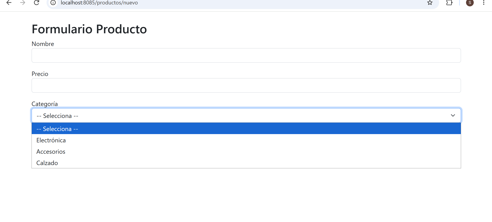
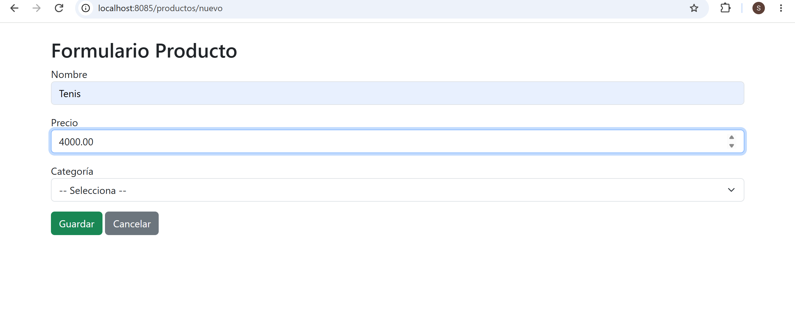
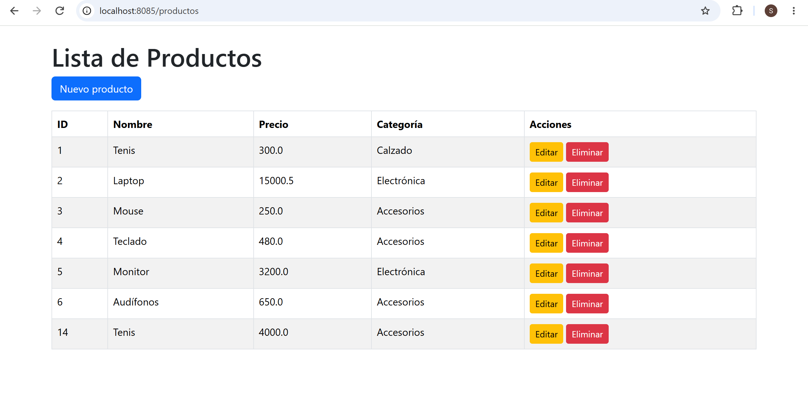
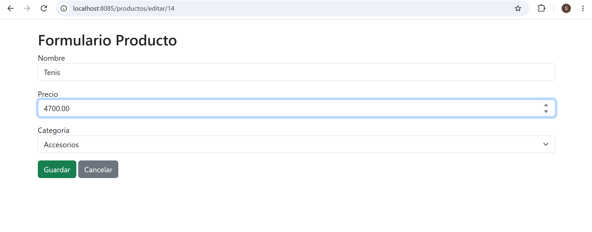
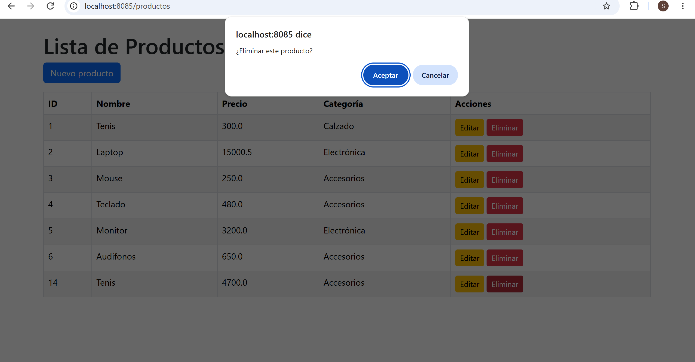

# 3. Act_3. CRUD en Spring Boot y Relaciones (sin frontend separado)

## CRUD de Productos y Categorías

## Hernández Guzmán Concepción Escarleth
## Programación Web

## Descripción del proyecto

Este proyecto consiste en un sistema CRUD desarrollado con Spring Boot, Java y MySQL. Permite realizar operaciones para registrar, consultar, actualizar y eliminar productos.

También cuenta con dos entidades relacionadas: Producto y Categoría. Un producto pertenece a una categoría, por lo que se utiliza una relación de muchos a uno (ManyToOne).

## Tecnologías utilizadas

- Java
- Spring Boot
- MySQL
- Spring Data JPA
- Thymeleaf
- HTML

## Entidades relacionadas

### Producto

La entidad Producto contiene los siguientes atributos:

- id
- nombre
- precio
- categoria

### Categoría

La entidad Categoría permite clasificar los productos registrados.

La relación se realiza mediante la llave foránea `categoria_id`, utilizando la anotación `@ManyToOne` en la entidad Producto.

### Evidencia de las entidades

## Operaciones CRUD

### 1. Crear

Se registra un producto nuevo ingresando su nombre, precio y seleccionando una categoría.

### 2. Leer

Se muestra la lista de productos registrados en la base de datos.

### 3. Actualizar

Se pueden modificar los datos de un producto que ya se encuentra registrado.

### 4. Eliminar

Se puede eliminar un producto de la base de datos.

## Relación entre Producto y Categoría

La relación permite que cada producto esté asociado con una categoría. Al consultar los productos, se puede identificar a qué categoría pertenece cada uno.

## Ejecución del proyecto

Para ejecutar el proyecto se utiliza Spring Boot desde Visual Studio Code.

El servidor se ejecuta localmente en el puerto 8085.

## Rutas del sistema

### Módulo de Ciudades

Permite consultar y administrar la información de las ciudades.

- Página principal: http://localhost:8085/
- Registrar ciudad: http://localhost:8085/nuevo

### Módulo de Productos

Permite realizar las operaciones CRUD de los productos.

- Consultar productos: http://localhost:8085/productos
- Registrar producto: http://localhost:8085/productos/nuevo
